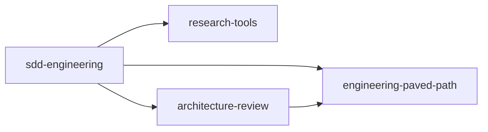

# sdd-engineering

Spec Driven Development for Claude Code: write a spec, plan it, run the plan through lanes,
checks and reviews, and report on the run. `sdd-engineering` is the top of the `sdd`
marketplace; installing it brings the three plugins it builds on.

## The four plugins

| Plugin | Ships | Depends on |
|---|---|---|
| `engineering-paved-path` | skills: `onion-architecture`, `frontend-ui-architecture`, `nextjs-app-router`, `react-best-practices`, `react-testing-library`, `fastify-best-practices`, `security` | — |
| `research-tools` | agent: `researcher` | — |
| `architecture-review` | agent: `architecture-reviewer`; its Bash guard | `engineering-paved-path ^1.0.0` |
| `sdd-engineering` | agents: `spec-creator`, `implementation-planner`, `implementer`, `plan-verifier`; skills: `run-plan`, `workflow-retro`, `spec-writing`, `mermaid-diagram`; scripts; guards | the three above, each `^1.0.0` |



Four edges: `sdd-engineering` → each of the other three, and `architecture-review` →
`engineering-paved-path`, so the reviewer's preloaded skills resolve when it is installed alone.

## The flow

```
feature request ─► spec-creator ─► spec (approved) ─► implementation-planner ─► plan ─► /run-plan ─► /workflow-retro
```

| Step | What happens | Supplied by |
|---|---|---|
| 1. Spec | `@agent-sdd-engineering:spec-creator` reads the context, asks for `research-tools:researcher` runs through the main session, reviews the designs, asks the user, then writes one draft spec (`spec-writing` method, EARS criteria, traceability) and approves it on the user's yes | `sdd-engineering` (+ `research-tools`) |
| 2. Plan | `@agent-sdd-engineering:implementation-planner` turns the approved spec into a Development Plan: lanes of at most 6 steps, test-first, Verify cells, skills per step, execution mode | `sdd-engineering` (+ `engineering-paved-path` skills) |
| 3. Run | `/sdd-engineering:run-plan <plan>` dispatches `sdd-engineering:implementer` per lane, runs the checks gate, then the review round in parallel — `architecture-review:architecture-reviewer`, `sdd-engineering:plan-verifier` (and the project's security reviewer, if any) — and budgeted fix rounds until clean | `sdd-engineering`, `architecture-review`, `research-tools`, `engineering-paved-path` |
| 4. Retro | `/sdd-engineering:workflow-retro <feature>` writes the run retro and one ledger row, with token usage and the plugin versions the run ran on | `sdd-engineering` |

Save the plan the planner returns to `<plans>/<feature>.plan.md` before step 3; the planner is
read-only. `run-plan` and `workflow-retro` run only when you type them
(`disable-model-invocation: true`).

## The project contract — `.sdd/config.json`

One optional file at the project root, read by the skills, the agents, the hooks and the
scripts. Without it the defaults apply, `run-plan` asks for the check commands once, and the
optional phases are skipped.

| Key | Meaning | Default |
|---|---|---|
| `context` | files every agent reads first: conventions, the ring map, lessons, testing rules | `[]` |
| `specs` | cross-module spec folder (one-package specs live in `<pkg>/.spec/`) | `"specs/"` |
| `plans` | plan folder | `"docs/plans/"` |
| `runs` | run state and reports | `".sdd/runs/"` |
| `checks` | per package, `typecheck` / `lint` / `test` / `arch` commands (other kinds, e.g. `it`, run in full mode only); the checks gate runs them, and the read-only reviewers' Bash guards admit exactly these strings | `{}` |
| `checksDir` | the recorded checks gate | `".sdd/checks/"` |
| `retros` | run retros and the ledger | `"docs/retros/"` |
| `routing` | path of the project's file → skill table, if it has one | `null` |
| `agents` | optional project agents `run-plan` uses when present: `test-writer`, `security-reviewer`, `retro-writer`, `doc-writer` | `[]` |
| `skills` | per plugin agent, project skills named in its brief, e.g. a lessons protocol for the implementer | `{}` |

A full example:

```json
{
  "context": ["docs/architecture.md", "docs/lessons.md"],
  "specs": "specs/",
  "plans": "docs/plans/",
  "runs": ".sdd/runs/",
  "checks": {
    "api": {
      "typecheck": "npm --prefix api run typecheck",
      "lint": "npm --prefix api run lint",
      "test": "npm --prefix api test",
      "arch": "npx --prefix api depcruise api/src --config api/.dependency-cruiser.cjs",
      "it": "npm --prefix api run test:integration"
    },
    "web": {
      "typecheck": "npm --prefix web run typecheck",
      "lint": "npm --prefix web run lint",
      "test": "npm --prefix web test"
    }
  },
  "checksDir": ".sdd/checks/",
  "retros": "docs/retros/",
  "routing": "docs/review-routing.md",
  "agents": ["test-writer", "security-reviewer"],
  "skills": { "implementer": ["lessons-protocol"] }
}
```

Commit `config.json` and ignore the rest of `.sdd/` (the trace, run state, checks records):

```gitignore
.sdd/*
!.sdd/config.json
```

## Install

In a session:

```text
/plugin marketplace add shofulk/sdd-marketplace
/plugin install sdd-engineering@sdd
```

From a shell: `claude plugin marketplace add shofulk/sdd-marketplace`, then
`claude plugin install sdd-engineering@sdd`. The three dependencies install with it.
`claude plugin list --json` then shows four plugins, enabled, with no `errors`.

### The stable channel

The root catalog (`sdd`) is the **latest** channel: it serves the plugins at the repository's
default branch. The **stable** channel is the `stable` branch, whose own root catalog is named
`sdd-stable` and carries the plugins at their released versions:

```text
/plugin marketplace add shofulk/sdd-marketplace#stable
/plugin install sdd-engineering@sdd-stable
```

or, for a whole project, in `.claude/settings.json` — the form
`claude plugin install sdd-engineering@sdd-stable --scope project` writes:

```json
{
  "extraKnownMarketplaces": {
    "sdd-stable": { "source": { "source": "github", "repo": "shofulk/sdd-marketplace", "ref": "stable" } }
  },
  "enabledPlugins": {
    "sdd-engineering@sdd-stable": true,
    "engineering-paved-path@sdd-stable": true,
    "research-tools@sdd-stable": true,
    "architecture-review@sdd-stable": true
  }
}
```

Project settings declare the plugins; they do not install them. A `claude -p` session does not
install them from these settings (measured on a real project, 2026-10-18), so each machine installs
them once: `claude plugin marketplace add shofulk/sdd-marketplace#stable`, then
`claude plugin install sdd-engineering@sdd-stable --scope project`. The three dependencies come
with it, and the settings file stays as above. `claude plugin marketplace remove sdd-stable`
removes the catalog from your user settings and also clears the project's `enabledPlugins` and
`extraKnownMarketplaces`; restore the file from git after it.

Claude Code has no release-channel concept and no downgrade command: going back to the stable
version means switching to the `sdd-stable` catalog. (A second catalog file pinning release
tags was measured not to pin the plugin it names, so the channel is a branch —
`docs/spikes/2026-10-17-spikes.md`, C2.) Release tags `<plugin>--v<version>` are kept: the
dependency ranges resolve against them. The `stable` branch was cut at the 1.0.0 release; a
release moves it once its smoke eval is green.

## Guards

Plugin agents ignore `hooks` and `permissionMode` in their frontmatter, so each plugin restores
its agents' guards in its own `hooks/hooks.json`, keyed by `agent_type`. A guard judges only the
agents it names; the main session is never blocked by an agent guard. Every guard fails open on
its own errors (one stderr line, exit 0); a block is exit 2 with the reason.

| Agent | Guard | Allows |
|---|---|---|
| `spec-creator` | `hooks/lib/bash-guard.mjs readonly`; `hooks/spec-guard.mjs` on Write/Edit | read-only Bash; writes only to draft `*.spec.md` files in the spec folders |
| `implementation-planner` | `bash-guard.mjs readonly` | read-only Bash (no redirection, no `cd`, no substitution, quoted globs) |
| `plan-verifier` | `bash-guard.mjs checks` | read-only Bash + the configured `checks` commands exactly + `scripts/checks.mjs` |
| `implementer` | `bash-guard.mjs implementer` | any Bash except commits, pushes and other history changes, `gh pr`, migrations, `psql`, `docker` |
| `architecture-reviewer` | `bash-guard.mjs checks` (in `architecture-review`) | as plan-verifier |
| every writer of a spec file | `hooks/spec-lint.mjs` pre / post | format errors are fed back after a write; approving a spec with format errors is blocked |

The planner, spec-creator and reviewers have no `permissionMode` either: their tool prompts
follow your session's permission mode.

## The trace — which version ran

Each of the four plugins has a `SessionStart` hook that appends
`{"time", "session_id", "plugin", "version"}` to `.sdd/trace.jsonl` in the project, the version
read from the installed copy's `plugin.json`. `run-plan` writes the four versions into the run
state (`Plugins:`), and `workflow-retro` prints them in the retro. They can be checked against
`claude plugin list --json` and the `init` message of `claude -p --output-format stream-json`,
which lists each loaded plugin with its version.

## Develop

From the marketplace repository root: `npm test` (node:test) and `npm run validate`
(`claude plugin validate --strict`). The shared hook code is edited in `tools/hooklib/` and
copied into each plugin's `hooks/lib/` with `npm run sync-hooklib`.

## Sources

See `NOTICE`.
